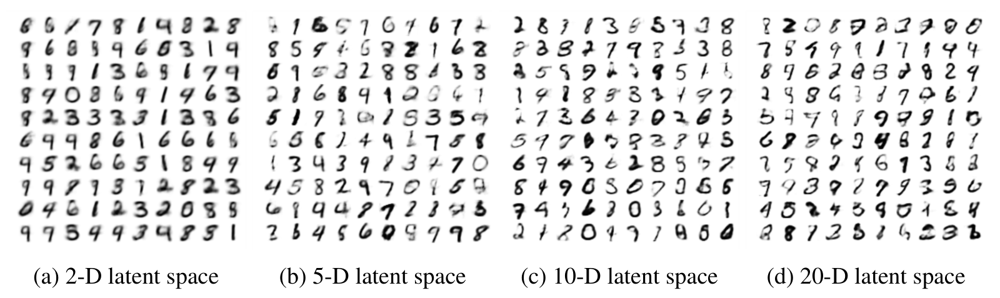
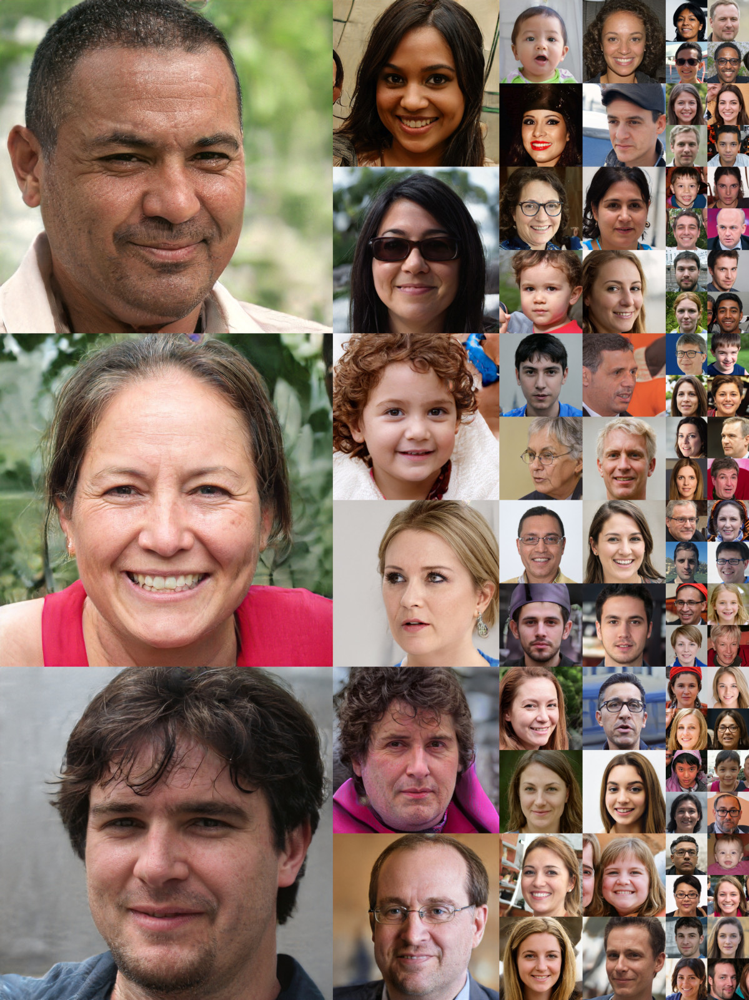
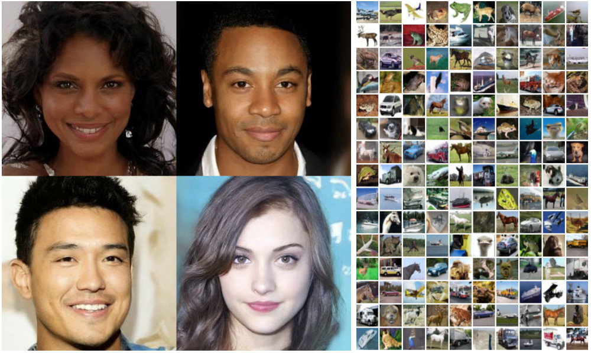
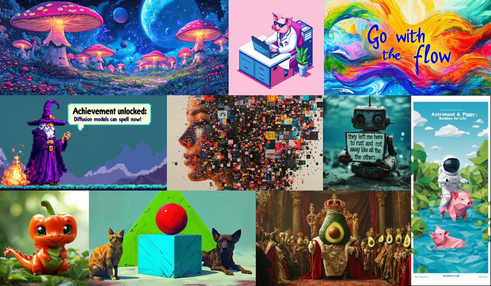

이번 글에서는 생성 모델의 개념과 이미지 생성 모델의 발전 과정을 소개합니다. **생성 모델은 데이터의 분포를 배운 뒤 새 샘플을 만드는 모델입니다.** 이 시리즈에서는 VAE, GAN, Diffusion부터 최근의 DiT와 Flow Matching까지 각 모델의 원리를 한 편씩 다룹니다. 첫 편에서는 모델 사이의 관계를 먼저 정리합니다. 지난 10여 년 동안 이미지 생성 모델은 앞선 모델의 한계를 줄이며 발전했습니다. 흐릿한 결과를 개선한 뒤에는 학습의 불안정성을 줄였고 생성 속도도 높였습니다.



> **이 글의 핵심**
> - 생성 모델은 **데이터 분포를 배우고, 그 분포에서 새 이미지를 뽑는** 모델입니다.
> - 이미지 생성 모델은 **흐릿한 결과(VAE) → 불안정한 학습(GAN) → 느린 생성(Diffusion)이라는** 한계를 차례로 넘으며 발전했습니다.
> - 최근 모델은 **Transformer 구조(DiT)와 곧은 경로로 생성하는 학습 방식(Flow Matching)을** 함께 씁니다.
{: .prompt-tip }

## 판별 모델과 생성 모델

딥러닝 모델은 하는 일에 따라 판별 모델(discriminative model)과 생성 모델(generative model)로 나눌 수 있습니다.

판별 모델은 입력의 종류나 특징을 판단합니다. 손글씨 숫자 이미지를 넣으면 레이블 7을 내놓는 분류 모델이 대표적입니다. 확률로 쓰면 **입력 $$x$$가 주어졌을 때 레이블 $$y$$의 확률 $$p(y \mid x)$$를 배우는 모델**입니다.

확률 표기가 낯설다면

- $$p(x)$$: 이미지 $$x$$가 얼마나 그럴듯한지를 나타내는 확률(연속값이면 확률 밀도)입니다.
- $$p(y \mid x)$$: 이미지 $$x$$가 주어졌을 때 레이블이 $$y$$일 확률입니다. 세로 막대 뒤가 주어진 조건입니다.
- $$p(x \mid c)$$: 조건 $$c$$가 주어졌을 때 이미지 $$x$$의 분포입니다. 글로 이미지를 만드는 모델에서는 프롬프트가 $$c$$입니다.

확률 분포와 샘플링의 기초는 3편에서 따로 다룹니다.

이미지 분야의 판별 모델은 무엇을 맞히느냐에 따라 다시 나뉩니다.

- **분류:** 이미지 전체가 무엇인지 맞힙니다. 예: ResNet, EfficientNet
- **객체 탐지:** 이미지 속 물체가 어디에 있고 무엇인지 함께 찾습니다. 예: YOLO, Faster R-CNN
- **분할:** 픽셀마다 어느 물체에 속하는지 정합니다. 예: Mask R-CNN, SAM



세 작업은 입력을 해석하는 방식이 다릅니다. 다만 **새 이미지를 만들지는 않습니다.**

생성 모델은 레이블 대신 **데이터 자체가 어떤 분포를 이루는지, 즉 $$p(x)$$를 배웁니다.** 학습한 분포에서 샘플을 뽑으면 학습 데이터에 없던 새 이미지를 만들 수 있습니다. 숫자 7처럼 원하는 종류의 이미지만 만들고 싶으면 조건 $$c$$를 붙인 조건부 분포 $$p(x \mid c)$$를 배웁니다. Stable Diffusion, DALL·E 2, Imagen처럼 글로 설명하면 이미지를 그려 주는 모델이 이 조건부 생성 모델입니다.



## 분포 학습과 샘플링

생성 모델이 이미지를 만드는 과정은 분포 학습과 샘플링 두 단계로 나눌 수 있습니다.

1. **분포 학습:** 많은 학습 이미지를 바탕으로 그럴듯한 이미지가 이미지 공간의 어디에 몰려 있는지 배웁니다. 손글씨 숫자 데이터라면 7의 형태를 갖춘 이미지와 0의 형태를 갖춘 이미지가 각각 모인 영역을 찾습니다.
2. **샘플링:** 배운 분포에서 무작위로 한 점을 뽑고, 그 점을 이미지로 만듭니다. 뽑을 때마다 다른 점이 나오므로 결과도 매번 달라집니다.

> 실제 이미지는 픽셀 수만큼 차원이 있어서, 28×28 흑백 숫자 이미지만 해도 784차원입니다. 아래 그림은 이해를 돕기 위해 이미지를 특징 두 개로 줄여 평면에 놓았다고 가정합니다.
{: .prompt-info }



조건부 생성에서는 두 번째 단계에서 조건에 맞는 샘플을 뽑습니다. 조건으로 숫자 7을 주면 모델은 학습한 분포 가운데 7에 해당하는 영역에서만 샘플을 뽑습니다. 결과는 매번 달라도 모두 7입니다.

> 텍스트 프롬프트로 이미지를 만드는 모델도 원리는 같습니다. **프롬프트가 조건 역할을 합니다.** 모델에 조건을 넣는 구체적인 방법은 9편에서 다룹니다.
{: .prompt-tip }

## 이미지 생성 모델의 발전 과정

이미지 생성 모델은 앞 세대가 남긴 문제를 다음 세대가 해결하는 방식으로 발전했습니다. 아래 그림은 세대별 특징과 한계를 정리한 것입니다.



### VAE

VAE(Variational Autoencoder)는 **이미지를 몇 개의 숫자로 요약했다가, 그 요약에서 이미지를 다시 그리는 모델**입니다. 인코더가 이미지를 저차원 잠재 벡터로 압축하고, 디코더가 잠재 벡터로부터 원래 이미지를 복원하도록 학습합니다.

일반적인 오토인코더와 다른 점은 잠재 벡터가 놓이는 자리를 정리해 둔다는 것입니다. VAE는 학습 이미지의 잠재 벡터들이 정규분포 모양으로 모이도록 함께 학습합니다. 그래서 생성할 때는 인코더 없이 정규분포에서 임의의 점을 뽑아 디코더에 넣기만 하면 새 이미지가 나옵니다.



결과가 흐릿한 이유도 학습 방식에서 나옵니다. 디코더는 픽셀 단위 복원 오차를 줄이도록 학습하는데, 하나의 잠재 벡터에 그럴듯한 이미지가 여러 개 대응하면 그 중간값을 그리는 편이 오차가 작습니다. 그래서 **세부 묘사가 평균처럼 뭉개지기 쉽습니다.**

_VAE가 생성한 손글씨 숫자. 잠재 공간의 차원이 작을수록 획이 더 뭉개집니다. 출처: Kingma & Welling (2013), [Figure 5](https://arxiv.org/abs/1312.6114)_

> **한계: 결과가 흐릿합니다.** 손실 함수와 함께 4편과 5편에서 자세히 다룹니다.
{: .prompt-warning }

### GAN

GAN(Generative Adversarial Network)은 **이미지를 만드는 네트워크와 진짜인지 가려내는 네트워크를 함께 학습시키는 모델**입니다. 생성자(generator)는 무작위 노이즈를 받아 이미지를 만들고, 판별자(discriminator)는 진짜 이미지와 생성된 이미지를 구분합니다. 생성자는 판별자가 진짜로 판정하도록, 판별자는 생성된 이미지를 놓치지 않도록 서로 반대 목표로 학습합니다.

이 구조에서는 판별자가 흐릿한 이미지를 쉽게 가짜로 가려냅니다. 생성자는 판별자를 통과하려고 질감과 윤곽 같은 세부를 살려야 하므로, **VAE보다 훨씬 선명한 이미지를 만듭니다.**



문제는 두 네트워크의 목표가 서로를 기준으로 계속 바뀐다는 점입니다. 한쪽이 지나치게 강해지면 다른 쪽이 배울 신호를 잃고 학습이 흔들립니다. 생성자가 판별자를 잘 속이는 몇 가지 이미지에만 몰려 다양성을 잃는 **모드 붕괴(mode collapse)가** 생기기도 합니다.

{: w="460" }
_GAN 계열 모델인 StyleGAN이 생성한 얼굴. 출처: Karras et al. (2019), [Figure 2](https://arxiv.org/abs/1812.04948)_

> **한계: 학습이 불안정하고 모드 붕괴가 생길 수 있습니다.** GAN의 구조와 이 문제는 6편과 7편에서 다룹니다.
{: .prompt-warning }

### Diffusion 모델

Diffusion 모델은 **노이즈에서 출발해 노이즈를 조금씩 걷어 내며 이미지를 만드는 모델**입니다. 학습에는 두 방향이 있습니다. 깨끗한 이미지에 노이즈를 단계마다 조금씩 더해 완전한 노이즈로 만드는 방향은 정해진 공식으로 계산합니다. 신경망은 그 반대 방향, 즉 노이즈가 섞인 이미지를 받아 한 단계 덜 흐린 이미지로 되돌리는 법을 배웁니다.

노이즈에서 한 번에 이미지를 만드는 일은 어렵지만, 노이즈를 조금 걷어 내는 한 단계는 훨씬 쉬운 문제입니다. Diffusion은 **어려운 문제를 쉬운 문제 여러 개로 나눠 푸는 방식**이라 학습이 안정적이고, 품질과 다양성도 함께 좋습니다.



대신 생성할 때 이 단계를 수십 번에서 많게는 1,000번까지 반복해야 해서 느립니다. 2022년에는 큰 이미지 대신 압축한 잠재 공간에서 같은 과정을 실행해 계산량을 줄인 Latent Diffusion이 Stable Diffusion으로 공개되면서, 누구나 고품질 이미지를 만들 수 있게 되었습니다.

_Diffusion 모델(DDPM)이 생성한 얼굴과 CIFAR-10 이미지. 출처: Ho et al. (2020), [Figure 1](https://arxiv.org/abs/2006.11239)_

> **한계: 생성이 느립니다.** Diffusion의 원리는 8편, Stable Diffusion은 10편, 생성 속도를 높이는 방법은 12편에서 다룹니다.
{: .prompt-warning }

### DiT와 Flow Matching

최근 모델은 Diffusion을 두 방향으로 개선했습니다.

- **DiT(Diffusion Transformer):** 이미지를 작은 패치로 잘라 문장의 단어처럼 나열하고, U-Net 대신 Transformer가 패치 사이의 관계를 계산합니다. 언어 모델처럼 **모델을 키울수록 품질이 꾸준히 좋아지는 확장성**이 장점입니다.
- **Flow Matching과 Rectified Flow:** Diffusion은 노이즈에서 이미지까지 휘어진 길을 작은 보폭으로 여러 번 나눠 갑니다. Flow Matching은 **노이즈와 이미지를 잇는 곧은 길을 배우도록** 학습해, 큰 보폭으로 적은 단계 만에 도착할 수 있게 합니다.



2024년에 나온 Stable Diffusion 3와 FLUX.1은 두 방향을 합쳐, Transformer 구조를 Rectified Flow 방식으로 학습한 모델입니다. 비디오 생성 모델 Sora도 Diffusion Transformer 구조를 씁니다. DiT는 13편, Flow Matching은 14편에서 다룹니다.

_Transformer 구조와 Rectified Flow를 쓰는 Stable Diffusion 3가 생성한 이미지. 출처: Esser et al. (2024), [Figure 1](https://arxiv.org/abs/2403.03206)_

### 모델별 특징 비교

| 계열 | 등장 | 대표 모델 | 특징 | 한계 |
|---|---|---|---|---|
| VAE | 2013 | VQ-VAE, β-VAE | 잠재 공간에서 샘플링 | 결과가 흐릿함 |
| GAN | 2014 | Pix2Pix, ProGAN, StyleGAN | 선명한 이미지 | 학습 불안정, 모드 붕괴 |
| Diffusion | 2015 (DDPM 2020) | DALL·E 2, Imagen, Stable Diffusion | 안정적인 학습, 높은 품질과 다양성 | 생성이 느림 |
| DiT, Flow Matching | 2022 | Stable Diffusion 3, FLUX.1, Sora | 모델 확장성, 적은 단계 생성 | - |

## 활용 분야와 확장 방향

**이미지 생성 모델은 여러 산업에서 쓰입니다.** 온라인 쇼핑몰에서는 상품 사진의 배경을 바꾸거나 한 상품을 여러 연출로 만드는 데 쓰고, 패션에서는 옷 사진을 모델이 입은 모습으로 합성하는 가상 피팅에 씁니다. 게임에서는 콘셉트 아트와 배경 텍스처의 초안을 빠르게 만드는 데 쓰입니다. 의료처럼 학습 데이터를 모으기 어려운 분야에서는 CT나 MRI 영상을 합성해 부족한 학습 데이터를 보강하는 연구가 이어지고 있습니다.

생성 대상도 정지 이미지를 넘어 넓어지고 있습니다.



비디오는 1분 안팎의 짧은 클립에서는 높은 품질을 보이지만, 긴 영상에서 인물과 장면을 일관되게 유지하는 일은 아직 풀어야 할 과제입니다. 3D에서는 여러 시점의 2D 이미지를 먼저 만들고 이를 바탕으로 3D 형상을 복원하는 방식이 많이 쓰입니다. 비디오와 3D 생성은 15편에서 자세히 다룹니다.

## 요약

- 판별 모델은 입력이 주어졌을 때의 레이블 분포 $$p(y \mid x)$$를 배우고, **생성 모델은 데이터 분포 $$p(x)$$를 배웁니다.**
- 생성 모델은 분포를 배운 뒤 그 분포에서 샘플을 뽑아 새 이미지를 만들고, 조건을 주면 조건에 맞는 영역에서만 뽑습니다.
- **VAE는 흐릿한 결과, GAN은 불안정한 학습, Diffusion은 느린 생성**이라는 한계를 남겼고, 다음 세대 모델이 이를 차례로 줄여 왔습니다.
- 최근 모델은 Transformer 구조(DiT)와 적은 단계로 생성하는 학습 방식(Flow Matching)을 함께 씁니다.
- 이미지 생성 기술은 비디오, 3D, 편집으로 넓어지고 있습니다.

다음 편에서는 VAE, GAN, Diffusion을 나란히 놓고 각 모델이 이미지를 만드는 방식과 장단점을 비교합니다.





## 참고 문헌

- Kingma, D. P., & Welling, M. (2013). Auto-Encoding Variational Bayes. arXiv:1312.6114.
- Goodfellow, I. et al. (2014). Generative Adversarial Nets. NeurIPS.
- Sohl-Dickstein, J. et al. (2015). Deep Unsupervised Learning using Nonequilibrium Thermodynamics. ICML.
- Karras, T., Laine, S., & Aila, T. (2019). A Style-Based Generator Architecture for Generative Adversarial Networks. CVPR.
- Ho, J., Jain, A., & Abbeel, P. (2020). Denoising Diffusion Probabilistic Models. NeurIPS.
- Rombach, R. et al. (2022). High-Resolution Image Synthesis with Latent Diffusion Models. CVPR.
- Peebles, W., & Xie, S. (2023). Scalable Diffusion Models with Transformers. ICCV.
- Lipman, Y. et al. (2023). Flow Matching for Generative Modeling. ICLR.
- Liu, X., Gong, C., & Liu, Q. (2023). Flow Straight and Fast: Learning to Generate and Transfer Data with Rectified Flow. ICLR.
- Esser, P. et al. (2024). Scaling Rectified Flow Transformers for High-Resolution Image Synthesis. ICML.
