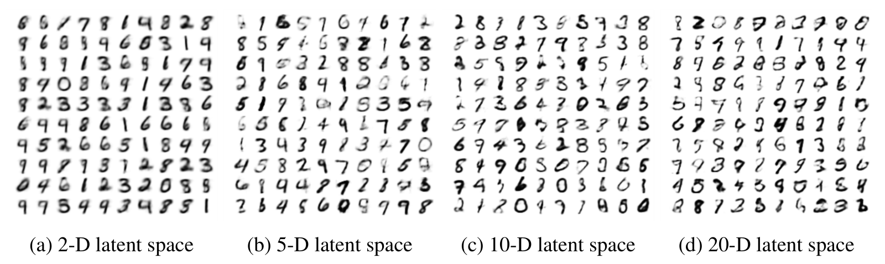
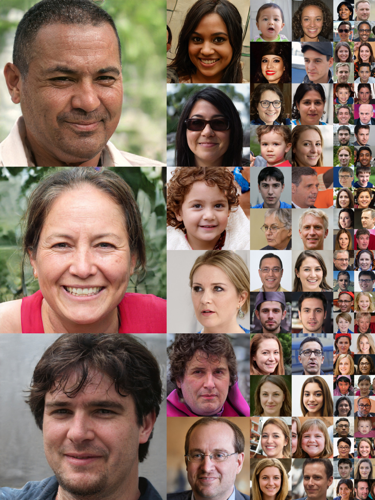
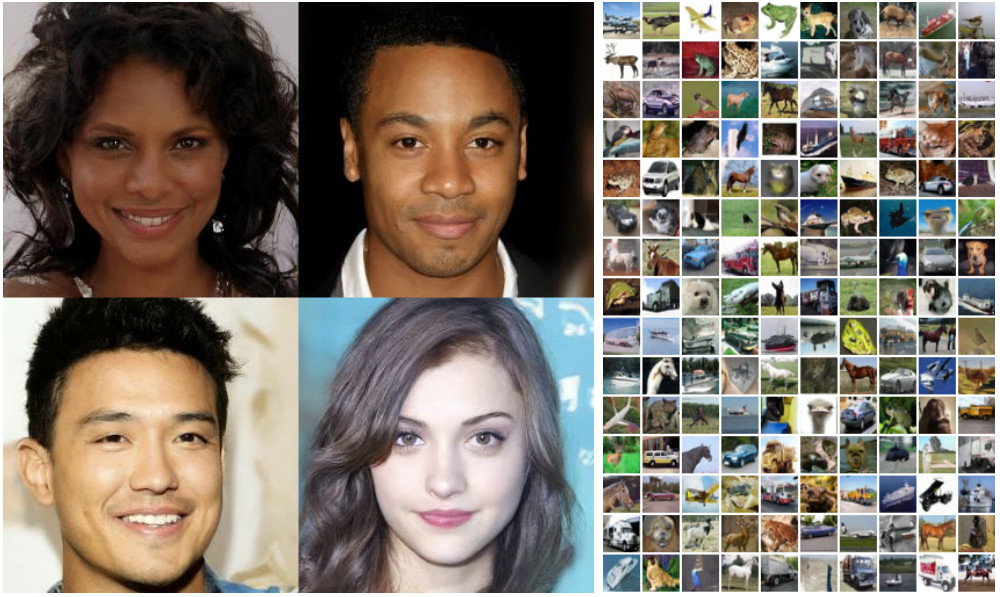

이번 글에서는 대표적인 이미지 생성 모델인 VAE와 GAN, Diffusion이 각각 이미지를 만드는 원리를 소개하고 세 모델의 특징을 비교하겠습니다. 1편에서는 생성 모델을 데이터 분포를 배우고 그 분포에서 새 샘플을 뽑는 모델로 정리했습니다. 세 모델은 같은 목표를 서로 다른 방식으로 이룹니다. **VAE는 이미지를 잠재 공간의 분포로 압축했다가 복원합니다. GAN은 이미지를 만드는 신경망과 진짜를 가려내는 신경망을 경쟁시킵니다. Diffusion은 노이즈를 조금씩 걷어 내며 이미지를 만듭니다.** 생성 방식이 다른 만큼 각 모델의 강점과 약점도 다릅니다.



> **이 글의 핵심**
> - **VAE**는 이미지를 잠재 공간의 정규분포로 압축하도록 학습합니다. 표준정규분포에서 뽑은 점을 디코더에 넣어 새 이미지를 만들며, 생성이 빠르고 학습이 안정적이지만 결과가 흐릿합니다.
> - **GAN**은 생성자와 판별자를 경쟁시켜 선명한 이미지를 만듭니다. 다만 학습이 불안정하고 모드 붕괴가 생길 수 있습니다.
> - **Diffusion**은 노이즈를 단계적으로 걷어 내는 방법을 배워 품질과 다양성이 모두 좋은 이미지를 만듭니다. 다만 여러 단계를 반복해야 하므로 생성이 느립니다.
{: .prompt-tip }

## VAE의 구조와 잠재 공간

VAE(Variational Autoencoder)는 **이미지를 잠재 공간의 확률분포로 압축했다가 다시 이미지로 복원하도록 학습하는 생성 모델**입니다. 기본 구조가 오토인코더와 같으므로 오토인코더부터 설명합니다.

### 오토인코더의 압축과 복원

오토인코더(autoencoder)는 두 신경망으로 이루어집니다.

1. **인코더:** 픽셀 수만큼의 차원을 가진 이미지를 훨씬 낮은 차원의 잠재 벡터(latent vector) $$z$$로 압축합니다. 이 과정에서 이미지를 다시 그리는 데 필요한 핵심 특징만 남깁니다.
2. **디코더:** 잠재 벡터 $$z$$를 받아 원래 크기의 이미지로 복원합니다.

학습 목표는 디코더가 복원한 이미지가 입력 이미지와 같아지도록 하는 것입니다. 입력 이미지 자체가 정답이므로 레이블이 필요 없습니다. 학습을 마친 뒤에는 주로 인코더를 사용하며, **이미지를 작은 벡터로 줄이는 차원 축소와 특징 추출에** 활용합니다.

### VAE의 확률적 잠재 표현

VAE도 인코더와 디코더로 이루어지지만 목적이 다릅니다. 오토인코더의 목적은 압축이고 VAE의 목적은 새 이미지 생성입니다. 따라서 VAE는 학습을 마친 뒤 주로 디코더를 사용합니다.

두 모델의 차이는 인코더의 출력에서 시작합니다. 오토인코더의 인코더는 이미지 한 장을 잠재 벡터 하나로 바꿉니다. 반면 **VAE의 인코더는 잠재 벡터 대신 정규분포의 평균 $$\mu$$와 분산 $$\sigma^2$$을 출력합니다.** 디코더는 이 분포에서 뽑은 $$z$$를 입력으로 받으므로, 같은 이미지를 넣어도 디코더에 전달되는 $$z$$는 조금씩 달라집니다.

VAE는 학습 과정에서 이미지마다 만들어진 분포들이 평균이 0이고 분산이 1인 표준정규분포 $$\mathcal{N}(0, I)$$ 근처에 모이도록 함께 조정합니다. 따라서 이미지를 생성할 때는 인코더 없이 $$\mathcal{N}(0, I)$$에서 점 하나를 뽑아 디코더에 넣으면 됩니다.



VAE라는 이름의 뜻

- **Variational:** 잠재 변수의 분포를 변분 추론(variational inference)이라는 근사 방법으로 학습한다는 뜻입니다. 인코더가 내는 정규분포가 이 근사 분포입니다.
- **Autoencoder:** 입력을 압축했다가 입력 자신으로 복원하도록 학습하는 구조라는 뜻입니다.

변분 추론과 VAE의 손실 함수는 5편에서 수식으로 유도합니다.

### 오토인코더와 VAE의 잠재 공간 비교

오토인코더에도 디코더가 있지만 이 디코더로 새 이미지를 만들기는 어렵습니다. **잠재 공간에 빈틈이 많기 때문입니다.**

오토인코더는 학습 이미지마다 잠재 공간의 점 하나를 정합니다. 복원만 잘되면 점이 어디에 놓여도 상관없으므로 점들은 별다른 제약 없이 흩어집니다. 점과 점 사이에는 디코더가 한 번도 학습하지 않은 빈 영역이 남습니다. 이 영역에서 고른 $$z$$를 디코더에 넣으면 알아볼 수 없는 이미지가 나옵니다.

VAE는 이미지마다 점 대신 작은 분포를 두고, 이 분포들을 모두 $$\mathcal{N}(0, I)$$ 안에 모읍니다. 분포들이 서로 겹치면서 잠재 공간이 빈틈없이 채워지므로 $$\mathcal{N}(0, I)$$에서 아무 점이나 뽑아도 그럴듯한 이미지가 나옵니다.



잠재 공간이 연속적으로 이어져 있으면 두 이미지 사이를 부드럽게 변화시킬 수도 있습니다. 두 이미지를 인코더에 넣어 얻은 잠재 벡터 $$z_1$$, $$z_2$$를 직선으로 잇고 그 사이의 점들을 디코더에 넣습니다. 그러면 한 이미지에서 다른 이미지로 조금씩 바뀌는 이미지들이 나옵니다. 이를 **보간(interpolation)이라고** 합니다. 두 벡터 사이의 점들은 학습 데이터에 없던 위치이므로 보간으로 얻은 이미지도 새 이미지입니다.



### VAE의 장점과 한계

VAE의 장점은 다음과 같습니다.

- **안정적인 학습:** 복원 오차와 분포를 $$\mathcal{N}(0, I)$$ 쪽으로 모으는 항을 합친 하나의 손실을 줄이므로 학습이 안정적으로 수렴합니다.
- **빠른 생성:** 디코더를 한 번 실행하면 이미지 한 장이 나옵니다.
- **연속적인 잠재 공간:** 보간처럼 잠재 공간을 따라 이미지를 조금씩 바꿀 수 있습니다.

한계는 **생성 결과가 흐릿하다는 점**입니다. 디코더는 복원 이미지와 원본 사이의 픽셀 차이를 줄이도록 학습합니다. 그런데 잠재 벡터 하나에 그럴듯한 이미지가 여러 장 대응하면, 그중 한 장을 선택할 때보다 여러 장의 평균을 그릴 때 픽셀 차이가 가장 작아집니다. 이렇게 평균을 낸 이미지는 세부가 뭉개집니다.



_VAE가 생성한 손글씨 숫자. 잠재 공간의 차원이 작을수록 획이 더 뭉개집니다. 출처: Kingma & Welling (2013), [Figure 5](https://arxiv.org/abs/1312.6114)_

> **한계: 결과가 흐릿합니다.** VAE의 구조와 학습 기법은 4편, 손실 함수(ELBO)는 5편에서 수식으로 다룹니다.
{: .prompt-warning }

## GAN의 구조와 경쟁 학습

GAN(Generative Adversarial Network)은 **이미지를 만드는 생성자와 진짜인지 가려내는 판별자를 경쟁시켜 학습하는 생성 모델**입니다. 이름에 쓰인 Adversarial(적대적)은 두 신경망의 경쟁 구조를 가리킵니다.

### 생성자와 판별자의 역할

- **생성자(generator) G:** 아무 의미도 담겨 있지 않은 무작위 노이즈 벡터 $$z$$를 받아 이미지를 만듭니다.
- **판별자(discriminator) D:** 이미지를 받아 학습 데이터에서 온 진짜 이미지일 확률을 출력합니다.

학습은 두 신경망을 번갈아 갱신하며 진행합니다.

1. **판별자 학습:** 진짜 이미지에는 1에 가까운 값을, 생성자가 만든 이미지에는 0에 가까운 값을 출력하도록 판별자를 갱신합니다.
2. **생성자 학습:** 판별자가 생성자의 이미지에도 1에 가까운 값을 출력하도록 생성자를 갱신합니다. 이때 판별자를 거쳐 역으로 전달된 기울기를 사용합니다.



생성자는 학습 데이터를 직접 보지 않습니다. **생성자가 받는 학습 신호는 판별자의 판정뿐입니다.** 판별자가 진짜와 가짜를 정확히 구분할수록 생성자가 받는 신호도 정확해지고, 생성자가 만드는 이미지도 진짜에 가까워집니다.

### GAN 결과의 선명도

VAE의 디코더는 픽셀 차이를 기준으로 학습하므로 여러 이미지의 평균처럼 흐릿한 이미지로 기웁니다. GAN의 생성자에게는 픽셀 차이라는 기준이 없고, 판별자를 통과하는지가 중요합니다. 판별자는 흐릿한 이미지를 쉽게 가짜로 구분하므로, 생성자는 **질감과 윤곽 같은 세부가 살아 있는 선명한 이미지를** 만들도록 학습됩니다. StyleGAN처럼 발전한 GAN은 실제 사진과 구분하기 어려운 얼굴을 만듭니다.

{: w="460" }
_GAN 계열 모델인 StyleGAN이 생성한 얼굴. 출처: Karras et al. (2019), [Figure 2](https://arxiv.org/abs/1812.04948)_

### 학습 불안정과 모드 붕괴

GAN의 약점은 학습 과정에 있습니다. 두 신경망은 서로를 기준으로 학습하므로 한쪽이 지나치게 강해지면 균형이 무너집니다. 예를 들어 판별자가 너무 빨리 강해지면 생성자가 만든 이미지를 모두 확신을 가지고 가짜로 판정합니다. 그러면 생성자는 무엇을 고쳐야 할지 알려 주는 신호를 거의 받지 못합니다.

학습이 불안정해지면 **모드 붕괴(mode collapse)가** 생기기도 합니다. 생성자가 판별자를 잘 속이는 몇 가지 이미지만 반복해서 만드는 현상입니다. 여기서 모드(mode)는 분포에서 데이터가 몰려 있는 봉우리를 뜻합니다. 손글씨 숫자에서는 0부터 9까지 각 숫자가 하나의 모드에 해당합니다. 모드 붕괴가 생기면 생성 결과가 일부 모드에만 몰려 다양성이 사라집니다.



> **한계: 학습이 불안정하고 모드 붕괴가 생길 수 있습니다.** GAN의 학습 목표는 6편, 모드 붕괴와 이를 줄인 후속 모델은 7편에서 다룹니다.
{: .prompt-warning }

## Diffusion 모델의 노이즈 추가와 제거

Diffusion 모델은 **이미지에 노이즈를 더하는 과정을 거꾸로 되돌리는 방법을 배워 순수한 노이즈에서 이미지를 만드는 생성 모델**입니다. 이름은 물리학의 확산(diffusion)에서 왔습니다. 확산은 한곳에 모여 있던 물질이 퍼져 고르게 섞이는 현상입니다. 물질이 완전히 섞이고 나면 처음의 모양을 알 수 없습니다. Diffusion 모델의 첫 논문(Sohl-Dickstein et al., 2015)은 비평형 열역학의 이 아이디어를 이미지 생성에 도입했습니다.

### 노이즈를 더하는 정방향 과정

정방향 과정(forward process)에서는 원본 이미지에 노이즈를 조금씩 여러 번 더합니다. 단계를 거듭할수록 이미지의 구조가 사라지고, 마지막에는 원본이 무엇이었는지 알 수 없는 순수한 노이즈만 남습니다. 물질이 완전히 퍼져 고르게 섞인 상태와 같습니다.

정방향 과정에서는 단계마다 더할 노이즈의 양이 공식으로 정해져 있으므로 학습할 것이 없습니다. 또한 **어떤 이미지에서 출발해도 마지막에는 표준정규분포 $$\mathcal{N}(0, I)$$를 따르는 노이즈가** 됩니다. $$\mathcal{N}(0, I)$$는 샘플을 뽑기가 매우 쉬운 분포입니다.

### 노이즈를 걷어 내는 역방향 과정

역방향 과정(reverse process)은 정방향 과정을 거꾸로 따라가며 노이즈에서 이미지로 돌아가는 과정입니다. 신경망은 노이즈가 섞인 이미지와 단계 번호를 받아 **이미지에 섞인 노이즈를 예측합니다.** 예측한 노이즈를 덜어 내면 노이즈가 한 단계 줄어든 이미지가 만들어집니다.

이미지 생성은 정방향 과정의 끝점에서 시작합니다. $$\mathcal{N}(0, I)$$에서 노이즈 이미지 하나를 뽑고 역방향 과정을 끝까지 거치면 새 이미지가 나옵니다. 출발점인 노이즈가 매번 다르므로 생성 결과도 매번 달라집니다.



### Diffusion의 장점과 한계

Diffusion은 **학습이 안정적입니다.** 신경망의 학습 목표는 이미지에 섞인 노이즈를 예측하는 것 하나입니다. GAN처럼 경쟁 상대가 없으므로 균형이 무너질 일이 없습니다. 노이즈를 한 번에 걷어 내지 않고 조금씩 제거하므로 각 단계에서 풀어야 할 문제도 쉽습니다. 그 결과 모드 붕괴 없이 학습 데이터 전체를 고르게 배워 품질과 다양성이 모두 좋은 이미지를 만듭니다. DALL·E 2와 Stable Diffusion 같은 텍스트-이미지 모델도 Diffusion을 바탕으로 합니다.

_Diffusion 모델(DDPM)이 생성한 얼굴과 CIFAR-10 이미지. 출처: Ho et al. (2020), [Figure 1](https://arxiv.org/abs/2006.11239)_

한계는 **생성 속도**입니다. 역방향 과정은 각 단계를 차례로 거쳐야 하며 단계마다 신경망을 한 번씩 실행합니다. DDPM은 1,000단계를 사용하므로 이미지 한 장을 만드는 데 신경망을 1,000번 실행합니다. 신경망을 한 번만 실행하는 VAE와 GAN보다 훨씬 느려 실시간 생성이 어렵습니다.



> **한계: 생성이 느립니다.** Diffusion의 원리와 학습 목표는 8편, 계산량을 줄인 Stable Diffusion은 10편, 단계 수를 줄이는 샘플링 가속 기법은 12편에서 다룹니다.
{: .prompt-warning }

## 세 모델의 특징 비교

결과 품질과 다양성, 생성 속도와 학습 안정성으로 비교하면 **세 모델 모두 약점이 하나씩 있습니다.**



각 모델이 이미지 한 장을 만드는 방식은 다음과 같습니다.

| | VAE | GAN | Diffusion |
|---|---|---|---|
| 생성할 때의 입력 | 잠재 벡터 | 노이즈 벡터 | 이미지 크기의 노이즈 |
| 신경망 실행 횟수 | 1번 (디코더) | 1번 (생성자) | 수십~1,000번 |
| 학습 신호 | 복원 오차, 분포를 모으는 항 | 판별자의 판정 | 노이즈 예측 오차 |
| 대표 약점 | 흐릿한 결과 | 불안정한 학습, 모드 붕괴 | 느린 생성 |

> 하나의 모델이 높은 품질과 다양성을 갖추면서 빠르게 생성하기는 어렵습니다. 이를 생성 학습의 트릴레마(generative learning trilemma)라고 부르기도 합니다(Xiao et al., 2022). 이후의 모델들은 이러한 약점을 줄이는 방향으로 발전했습니다. Latent Diffusion은 압축한 잠재 공간에서 Diffusion을 실행해 계산량을 줄였습니다. 샘플링 가속 기법과 Rectified Flow는 생성에 필요한 단계 수를 줄였습니다.
{: .prompt-info }

## 요약

- VAE는 이미지를 잠재 공간의 정규분포로 압축하고 그 분포들을 $$\mathcal{N}(0, I)$$ 안에 모읍니다. **$$\mathcal{N}(0, I)$$에서 뽑은 점을 디코더에 넣어 새 이미지를 만듭니다.** 생성이 빠르고 학습이 안정적이지만 결과가 흐릿합니다.
- 오토인코더는 잠재 공간에 빈틈이 많아 이미지 생성에 사용하기 어렵습니다. VAE는 잠재 공간을 빈틈없이 채우므로 생성과 보간이 가능합니다.
- GAN은 생성자와 판별자를 경쟁시켜 **선명한 이미지를 만듭니다.** 다만 학습이 불안정하고 모드 붕괴로 다양성을 잃을 수 있습니다.
- Diffusion은 노이즈를 더하는 정해진 과정을 거꾸로 되돌리는 방법을 배웁니다. **생성 결과의 품질과 다양성이 모두 좋지만**, 여러 단계를 반복해야 하므로 생성이 느립니다.

## 자주 묻는 질문



다음 편에서는 세 모델을 수식으로 다루기에 앞서 필요한 확률 분포와 샘플링의 기초를 정리합니다.





## 참고 문헌

- Hinton, G. E., & Salakhutdinov, R. R. (2006). Reducing the Dimensionality of Data with Neural Networks. Science.
- Kingma, D. P., & Welling, M. (2013). Auto-Encoding Variational Bayes. arXiv:1312.6114.
- Goodfellow, I. et al. (2014). Generative Adversarial Nets. NeurIPS.
- Sohl-Dickstein, J. et al. (2015). Deep Unsupervised Learning using Nonequilibrium Thermodynamics. ICML.
- Karras, T., Laine, S., & Aila, T. (2019). A Style-Based Generator Architecture for Generative Adversarial Networks. CVPR.
- Ho, J., Jain, A., & Abbeel, P. (2020). Denoising Diffusion Probabilistic Models. NeurIPS.
- Xiao, Z., Kreis, K., & Vahdat, A. (2022). Tackling the Generative Learning Trilemma with Denoising Diffusion GANs. ICLR.
